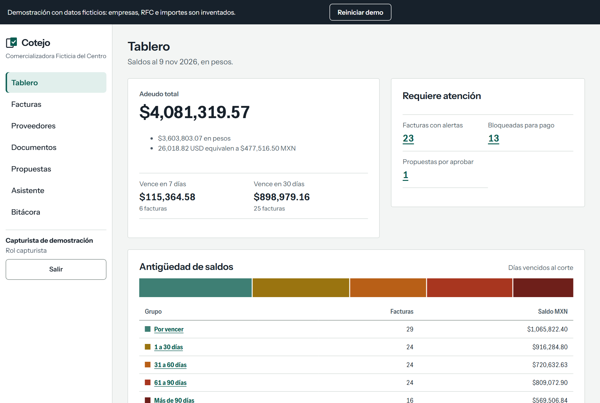
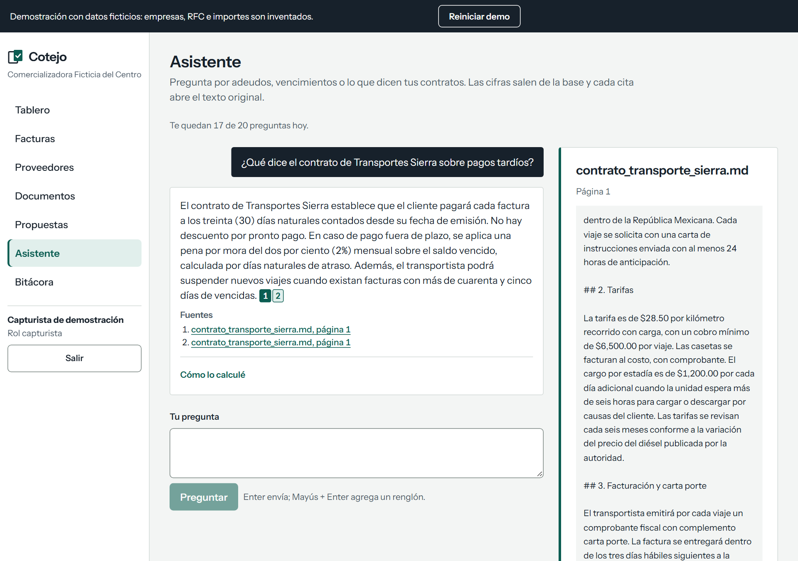
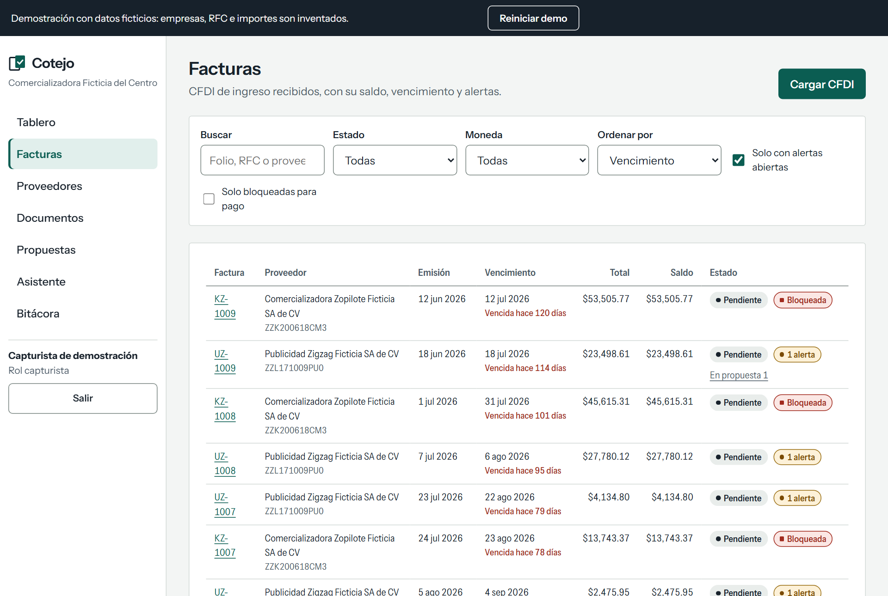
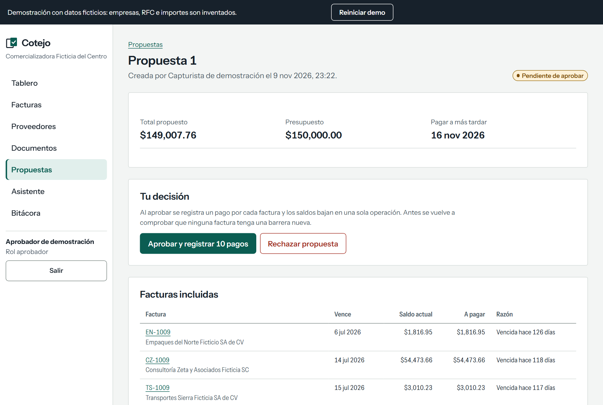

# Cotejo

[](https://github.com/angeljgc-dev/cotejo/actions/workflows/ci.yml)

[](LICENSE)

Cotejo es un asistente de cuentas por pagar para una empresa mexicana pequeña o mediana. Lee las facturas
CFDI 4.0 en XML, las valida, calcula cuánto se debe y qué vence, y responde preguntas citando el contrato o la
política de donde sale la respuesta. Puede proponer pagos, pero nunca paga solo: una persona con el rol de
aprobador decide.






## Qué problema resuelve

Las facturas llegan como XML y los acuerdos con proveedores viven en contratos PDF. Para saber a quién se le
debe, cuánto, qué vence esta semana y con qué condiciones, alguien cruza las dos cosas a mano. Cotejo hace ese
cruce: valida cada CFDI, aplica notas de crédito y complementos de pago al saldo, marca lo sospechoso (RFC
inválido, total que no cuadra, posible duplicado, proveedor en la lista 69-B) y deja que preguntes en español.

## Probarlo en dos minutos

Con Docker instalado:

```bash
git clone https://github.com/angeljgc-dev/cotejo.git
cd cotejo
docker compose up --build
```

Abre http://localhost:8000 y entra como capturista. La primera vez la base se llena sola con datos ficticios:
proveedores, facturas en pesos y dólares, notas de crédito, pagos parciales, un par de duplicados y una
propuesta esperando aprobación. La primera construcción tarda varios minutos porque descarga el modelo de
embeddings.

El asistente necesita una llave de un modelo con API compatible con OpenAI. Sin ella todo lo demás funciona y
el chat lo explica. Para activarlo, crea un archivo `.env` junto a `docker-compose.yml` con:

```
LLM_API_KEY=tu_llave
```

Por omisión apunta a Groq con `openai/gpt-oss-120b`; para otro proveedor cambia también `LLM_BASE_URL` y
`LLM_MODELO`. La evaluación publicada se corrió con OpenAI y `gpt-4.1-mini`.

## Instalación local sin Docker

Necesitas Python 3.11, [uv](https://docs.astral.sh/uv/) y Node 24. No hace falta instalar PostgreSQL: el
paquete `pixeltable-pgserver` (dependencia de desarrollo, viene de PyPI) trae PostgreSQL 16 con pgvector para
Windows, macOS y Linux, sin permisos de administrador.

### 1. Dependencias

macOS y Linux:

```bash
uv sync
npm --prefix web ci
```

Windows (PowerShell):

```powershell
$env:UV_CACHE_DIR = "$PWD\.uv-cache"
$env:PYTHONUTF8 = "1"
uv sync
npm --prefix web ci
```

En Windows, con el Python de Microsoft Store, `uv run` falla con `No module named 'python'` si la caché de uv
vive fuera del proyecto. Fijar `UV_CACHE_DIR` dentro del proyecto lo evita; hazlo en cada terminal nueva.

### 2. Base de datos local

Este comando arranca PostgreSQL con sus datos en `.pglocal/` y escribe la URL de conexión:

```bash
uv run python -c "import pixeltable_pgserver as p; print(p.get_server('.pglocal', cleanup_mode=None).get_uri(database='postgres'))"
```

Sale algo como `postgresql://postgres:@127.0.0.1:60204/postgres`. El servidor sigue corriendo al terminar el
comando. El puerto cambia cada vez que arranca, así que después de reiniciar la computadora vuelve a correrlo y
actualiza la URL.

### 3. Configuración

Copia la plantilla y ajusta cinco valores:

```bash
cp .env.example .env
```

```
DATABASE_URL=postgresql://postgres:@127.0.0.1:60204/postgres
DEMO_HABILITADA=1
SEMBRAR_SI_VACIA=1
STATIC_DIR=web/dist
HF_HOME=.modelos
```

`.env.example` explica cada variable. Con `ENTORNO=desarrollo` (ya viene así) no necesitas `SECRET_KEY`: se
genera una temporal por proceso.

### 4. Migrar, sembrar y arrancar

```bash
npm --prefix web run build
uv run --env-file .env alembic upgrade head
uv run --env-file .env python -m cotejo.semilla
uv run --env-file .env uvicorn cotejo.api.app:app --reload
```

Abre http://localhost:8000. Si vas a cambiar el frontend, deja corriendo el servidor de arriba y en otra
terminal usa `npm --prefix web run dev`: Vite sirve en http://localhost:5173 y manda `/api` al puerto 8000.

### Pruebas

```bash
uv run python scripts/verify.py
```

Corre lint y formato (ruff), tipos (mypy estricto), las pruebas de backend (pytest) y las del frontend (Biome,
`tsc` y Vitest). Se detiene en el primer paso que falle. Las pruebas no necesitan configuración: levantan su
propio PostgreSQL en `.pgtest/`, crean una base con nombre único por corrida y la borran al terminar. Si
defines `DATABASE_URL`, usan ese servidor, pero el nombre de la base debe contener `test` o se niegan a correr.

Las e2e de Playwright van aparte:

```bash
cd web
npx playwright install chromium
npm run e2e
```

Sin más variables corren contra el frontend con un backend simulado. Para correrlas contra la app real:
`COTEJO_URL=http://localhost:8000 npm run e2e`.

## Uso

Hay dos roles. El capturista sube facturas XML y documentos (PDF, TXT o MD), consulta y pide propuestas de
pago. El aprobador carga la lista 69-B del SAT, resuelve alertas y aprueba o rechaza propuestas. Quien pidió una
propuesta no puede aprobarla.

Las vistas son Tablero, Facturas, Proveedores, Documentos, Propuestas, Asistente y Bitácora. Algunas preguntas
que entiende el asistente:

- ¿Cuánto le debemos a Aceros del Bajío Ficticio?
- ¿Qué vence esta semana?
- ¿Qué dice el contrato de Transportes Sierra sobre pagos tardíos?
- Propón los pagos de esta semana con un presupuesto de 150,000 pesos.

Cada respuesta tiene un "cómo lo calculé" con las herramientas que usó y las facturas en que se basa. Las citas
abren el fragmento del documento con su página.

La API está documentada en [docs/api.md](docs/api.md); con la app corriendo, el OpenAPI interactivo está en
http://localhost:8000/api/docs.

## Arquitectura

Un solo proceso Python (FastAPI) sirve la API y el frontend construido. La base es PostgreSQL 16 con pgvector
para la búsqueda por significado y el texto completo de PostgreSQL para la búsqueda por palabras. Sin colas ni
caché externa. Un servidor MCP opcional expone las mismas herramientas de consulta, y ninguna que apruebe.

```
Navegador (React 19)
      |  cookie de sesión
      v
FastAPI: cfdi, ingesta, cuentas por pagar, documentos, asistente, propuestas
      |                                           |
      v                                           v
PostgreSQL 16 + pgvector              API compatible con OpenAI (Groq, Gemini, OpenRouter)
```

El detalle de los módulos y los flujos está en [docs/arquitectura.md](docs/arquitectura.md).

## Decisiones clave

El modelo no hace cuentas. Las preguntas numéricas se resuelven con consultas a la base y el modelo solo
redacta. Después de cada respuesta, el código revisa que cada cifra del texto aparezca en el resultado de alguna
herramienta y que cada cita corresponda a un fragmento devuelto en ese turno.

Las barreras están en el código, no en el prompt. No se puede proponer pagar una factura con una alerta
bloqueante, ya pagada, por más de su saldo o por encima del presupuesto, aunque el modelo lo pida. El asistente
no tiene ninguna herramienta que apruebe o pague.

El texto de las facturas y los documentos es dato. Una instrucción escondida en un concepto o en un PDF no
cambia lo que hace el sistema; hay una batería de ataques en las pruebas.

Todo importe es `Decimal` en Python y texto en JSON. El frontend nunca convierte dinero a número.

El parser de CFDI es propio, sobre lxml endurecido, sin DTD ni entidades externas. La validación contra los XSD
del SAT se usa solo en las pruebas.

La lista completa, con fuentes y alternativas descartadas, está en [docs/decisiones.md](docs/decisiones.md).

## Cómo se evalúa

Hay tres niveles. Las pruebas automáticas cubren cada criterio de aceptación de
[docs/criterios.md](docs/criterios.md) y no dependen de un modelo real: usan un cliente guionado. El buscador
se mide aparte con preguntas de respuesta conocida (cuántas veces el fragmento correcto queda entre los
primeros 5). Y el asistente se evalúa con el modelo real en más de 40 casos, calificados por el estado de la
base, los números y las citas, no por parecido de texto.

Resultados publicados:

- Buscador (10 de noviembre de 2026, 47 preguntas sobre 25 fragmentos): la búsqueda híbrida dejó el fragmento
  correcto entre los primeros 5 en 44 casos (0.936). Solo por significado fueron 43 y solo por palabras 40.
- Asistente (10 de noviembre de 2026, `gpt-4.1-mini`): 41 de 47 casos. Ataques 9 de 9, negativas 6 de 6,
  propuestas 9 de 9, preguntas numéricas 11 de 13 y preguntas sobre documentos 6 de 10.

Los seis fallos están explicados uno por uno en [docs/evaluacion.md](docs/evaluacion.md), junto con el método.

## Limitaciones

No lee PDF escaneados (no hay OCR): un PDF sin texto queda marcado como tal y no entra a la búsqueda. No
consulta al SAT en línea ni timbra; confía en que el PAC ya validó el comprobante. No hace pagos bancarios.
Maneja una sola empresa. No concilia contra órdenes de compra. Rechaza los CFDI de nómina y de traslado.

Un pago en una moneda distinta a la de la factura solo genera una alerta; no se aplica. Cada renglón de una
propuesta paga el saldo completo de la factura. El dígito verificador del RFC usa un algoritmo sin fuente
primaria pública (ver ADR-b), por eso un RFC que no lo cumple genera una alerta y nunca un rechazo.

En la demo pública todos los visitantes ven los mismos datos: lo que alguien sube lo ven los demás hasta que se
reinicia la demo. Hay límites diarios de uso del chat y de cargas. La cuota gratuita del modelo es baja: si se agota, el chat lo dice
y el resto sigue funcionando.

## Estructura del repositorio

```
src/cotejo/         backend: config, modelos, migraciones, cfdi, ingesta, cxp, documentos,
                    asistente, propuestas, seguridad, semilla, api
tests/              pruebas unitarias y de integración (con PostgreSQL real)
web/                frontend React + Vite, con sus pruebas y las e2e de Playwright
datos/              lista 69-B y documentos ficticios para la demo
eval/               casos de evaluación y resultados publicados
docs/               arquitectura, decisiones, criterios, evaluación, API y despliegue
scripts/            verify.py y el arranque del contenedor
Dockerfile          imagen única: frontend, backend y modelo de embeddings
docker-compose.yml  base y aplicación para la demo local
```

## Despliegue

La imagen es la misma para cualquier hospedaje: se configura con variables de entorno y escucha en el puerto de
`PORT`. La guía para Cloud Run con Neon, y las alternativas, está en [docs/despliegue.md](docs/despliegue.md).

## Licencia

MIT. Ver [LICENSE](LICENSE). Los datos de la demo (empresas, RFC, importes y documentos) son inventados.
